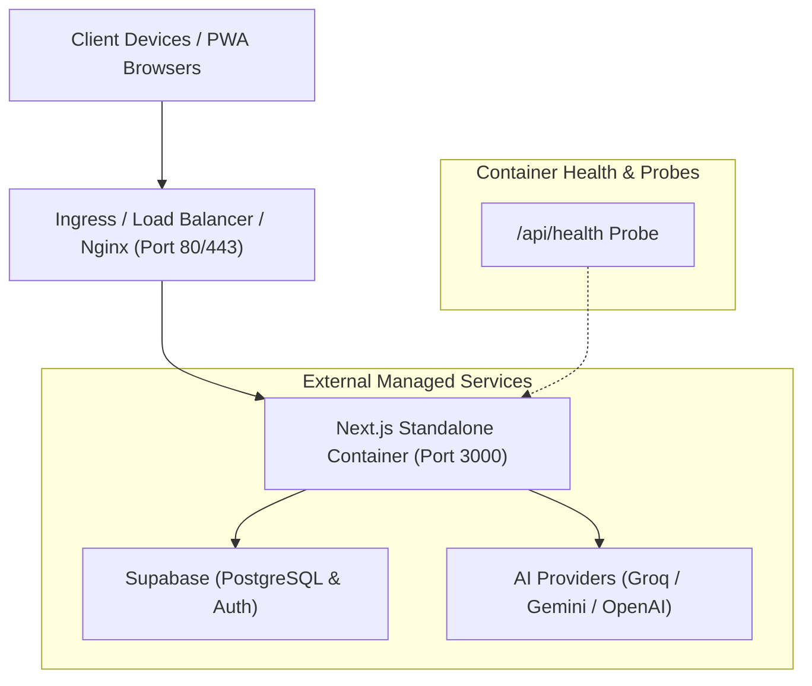

# MaintAI DevOps Operations & Infrastructure Guide

This guide documents the production-grade DevOps architecture, containerization, CI/CD automation, Kubernetes deployment, and observability for **MaintAI (Industrial Maintenance Assistant)**.

---

## Table of Contents
1. [Architecture Overview](#architecture-overview)
2. [Quick Commands & Automation](#quick-commands--automation)
3. [Containerization with Docker](#containerization-with-docker)
4. [Docker Compose Environments](#docker-compose-environments)
5. [Nginx Reverse Proxy & Hardening](#nginx-reverse-proxy--hardening)
6. [CI/CD Pipelines (GitHub Actions)](#cicd-pipelines-github-actions)
7. [Kubernetes (K8s) Deployment](#kubernetes-k8s-deployment)
8. [Observability & Health Checks](#observability--health-checks)
9. [Disaster Recovery & Troubleshooting](#disaster-recovery--troubleshooting)

---

## Architecture Overview



---

## Quick Commands & Automation

We provide both a **Makefile** (Linux/macOS) and a **PowerShell script** (`scripts/devops.ps1` for Windows).

### PowerShell (Windows)
```powershell
# Show all available commands
.\scripts\devops.ps1 help

# Quality checks
.\scripts\devops.ps1 typecheck
.\scripts\devops.ps1 lint

# Build standalone application
.\scripts\devops.ps1 build

# Docker container operations
.\scripts\devops.ps1 docker-build
.\scripts\devops.ps1 docker-run
.\scripts\devops.ps1 up            # Run in background via Docker Compose
.\scripts\devops.ps1 up-proxy      # Run with Nginx reverse proxy
.\scripts\devops.ps1 down          # Stop containers
.\scripts\devops.ps1 health        # Query health check endpoint
```

### Makefile (Linux / macOS / WSL)
```bash
make help               # Display list of all targets
make typecheck          # Verify TypeScript types
make build              # Build standalone Next.js bundle
make docker-build       # Build production image
make docker-up          # Start Docker Compose stack
make docker-up-proxy    # Start with Nginx
make health             # Test /api/health
make docker-down        # Stop stack
```

### npm Scripts
```bash
npm run typecheck       # TypeScript verification
npm run docker:build    # Build maintai:latest
npm run docker:run      # Run container with .env.local
npm run docker:compose  # Start compose in background
npm run docker:compose:down
```

---

## Containerization with Docker

The application uses an optimized **4-stage multi-stage Docker build** (`Dockerfile`) targeting `node:20-alpine`:

1. **`base`**: Minimal Alpine Node.js 20 environment with `libc6-compat`.
2. **`deps`**: Installs dependencies cleanly using `npm ci`.
3. **`builder`**: Injects fallback build-time environment variables and executes `npm run build` using Next.js standalone mode (`output: "standalone"`).
4. **`runner`**: Creates an unprivileged system user (`nextjs:nodejs`, UID 1001), copies only the standalone server and static files, defines native container healthchecks, and exposes port `3000`.

### Build & Run
```bash
# Build image
docker build -t maintai:latest .

# Run image with your environment variables
docker run -d --name maintai-app -p 3000:3000 --env-file .env.local maintai:latest
```

---

## Docker Compose Environments

### Production / Staging (`docker-compose.yml`)
Run the core app:
```bash
docker compose up -d
```

Run with Nginx reverse proxy included:
```bash
docker compose --profile proxy up -d
```

### Containerized Development (`docker-compose.dev.yml`)
For developers who want to run the full stack inside Docker with live volume hot-reloading:
```bash
docker compose -f docker-compose.dev.yml up
```

---

## Nginx Reverse Proxy & Hardening

`nginx/nginx.conf` is optimized for Next.js PWA workloads:
- **Immutable Static Asset Caching**: `/_next/static/*` assets are served with `Cache-Control: "public, max-age=31536000, immutable"`.
- **Gzip Compression**: Compresses text, JSON, SVG, CSS, and JS payloads to reduce bandwidth and latency.
- **WebSocket Upgrade**: Supports real-time subscriptions and PWA service workers.
- **Security Headers**:
  - `X-Content-Type-Options: nosniff`
  - `X-Frame-Options: SAMEORIGIN`
  - `X-XSS-Protection: 1; mode=block`
  - `Referrer-Policy: strict-origin-when-cross-origin`
- **Health Check Bypass**: Logs for `/api/health` are suppressed to prevent log pollution.

---

## CI/CD Pipelines (GitHub Actions)

Three workflows are configured in `.github/workflows/`:

### 1. Continuous Integration (`ci.yml`)
- Triggers on `push` and `pull_request` to `main`, `master`, and `develop`.
- Runs:
  - `npm run typecheck` (TypeScript strict check)
  - `npm run lint` (ESLint)
  - `npm run build` (Ensures standalone output builds successfully)
  - `npm audit --audit-level=high` (Security vulnerability audit)

### 2. Automated Container Build & Push (`docker-build-push.yml`)
- Builds multi-layer cached Docker container using Buildx.
- Automatically authenticates with **GitHub Container Registry (GHCR)** using `${{ secrets.GITHUB_TOKEN }}`.
- Tags images with commit SHA, branch name, semver tags (`v1.0.0`), and `latest`.

### 3. Continuous Deployment (`cd-deploy.yml`)
- Automatically triggers upon successful container build or via manual workflow dispatch.
- Supports SSH automated rollout to production servers via Docker Compose.
- **Required Repository Secrets** (for SSH deployment):
  - `DEPLOY_HOST`: Target server IP or hostname.
  - `DEPLOY_USER`: SSH username (e.g. `ubuntu` or `deploy`).
  - `DEPLOY_SSH_KEY`: Private SSH key.
  - `DEPLOY_PORT`: SSH port (defaults to 22).

---

## Kubernetes (K8s) Deployment

The `deploy/k8s/` directory contains cloud-native manifests:

| Manifest | Purpose |
|---|---|
| `configmap.yaml` | Non-sensitive configurations (`NODE_ENV`, `AI_PROVIDER`, models) |
| `secret.template.yaml` | Supabase URL/keys and AI provider API tokens |
| `deployment.yaml` | 2 replicas, rolling updates, security context (UID 1001), CPU/Memory limits, liveness & readiness probes |
| `service.yaml` | ClusterIP service exposing port 3000 on port 80 |
| `ingress.yaml` | Nginx Ingress Controller routing and Let's Encrypt TLS cert annotations |
| `hpa.yaml` | Autoscales from 2 to 10 pods based on 70% CPU and 80% RAM utilization |

### Deploying to a Kubernetes Cluster
```bash
# 1. Create secret from template (fill your real credentials first)
cp deploy/k8s/secret.template.yaml deploy/k8s/secrets.yaml
kubectl apply -f deploy/k8s/secrets.yaml

# 2. Apply config, deployment, service, ingress, and HPA
kubectl apply -f deploy/k8s/configmap.yaml
kubectl apply -f deploy/k8s/deployment.yaml
kubectl apply -f deploy/k8s/service.yaml
kubectl apply -f deploy/k8s/ingress.yaml
kubectl apply -f deploy/k8s/hpa.yaml

# 3. Monitor rollout status
kubectl rollout status deployment/maintai-app
```

---

## Observability & Health Checks

The application provides an enterprise health endpoint at `/api/health`:

### Request
```bash
GET /api/health
```

### Sample Response (HTTP 200)
```json
{
  "status": "healthy",
  "service": "maintai-assistant",
  "version": "0.1.0",
  "timestamp": "2026-09-01T12:30:00.000Z",
  "uptime": "420s",
  "uptimeSeconds": 420,
  "environment": "production",
  "checks": {
    "database": {
      "status": "configured",
      "type": "supabase"
    },
    "ai": {
      "provider": "groq",
      "groqConfigured": true,
      "geminiConfigured": true,
      "openaiConfigured": false,
      "mode": "live"
    }
  },
  "system": {
    "nodeVersion": "v20.14.0",
    "platform": "linux",
    "arch": "x64",
    "memoryUsageMb": {
      "rss": 75.42,
      "heapTotal": 54.12,
      "heapUsed": 38.64
    }
  },
  "latencyMs": 1
}
```

This endpoint is integrated into:
- Docker container `HEALTHCHECK` directive
- Docker Compose service healthcheck
- Kubernetes `livenessProbe` and `readinessProbe`
- Nginx upstream health routing

---

## Disaster Recovery & Troubleshooting

### Common Scenarios

#### 1. Container fails healthcheck
- Check logs: `docker compose logs --tail=100 maintai-app`
- Verify environment variables: confirm `NEXT_PUBLIC_SUPABASE_URL` and `NEXT_PUBLIC_SUPABASE_ANON_KEY` are provided.
- Run interactive shell: `docker exec -it maintai-app sh`

#### 2. Rebuilding after dependency changes
```bash
docker compose down
docker compose build --no-cache maintai-app
docker compose up -d
```

#### 3. Database migrations
All Supabase SQL migrations reside in `supabase/migrations/`.
- Apply migrations sequentially in Supabase dashboard SQL editor or via Supabase CLI:
  ```bash
  npx supabase db push
  ```
